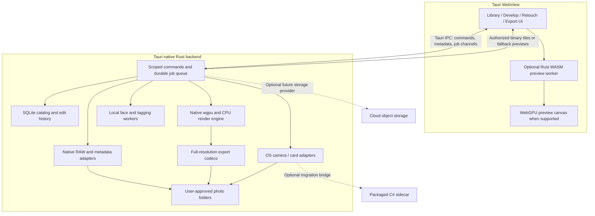

# PhotoGreen: Local-First Tauri Application Plan

**Status:** Proposed architecture and delivery plan, not an implementation commitment.
**Updated:** 2026-09-20.
**Goal:** Replace the user's Lightroom and Photoshop photography workflows with a local-first Tauri desktop application, using native Rust and GPU acceleration, with WebAssembly where it provides a useful WebView or future browser execution path.

**Development home:** `C:\src\photogreen-tauri`. Continue implementation there, not in this WPF checkout. The destination's root plan is authoritative for future Tauri work; this document is the WPF-side handoff snapshot. Section 16 contains tool installation, non-destructive scaffolding, and verification instructions.

## 1. Recommendation

**Build PhotoGreen as a Tauri 2 desktop application: a web-technology interface, a native Rust backend, and a shared Rust image engine.** This replaces the earlier browser-plus-companion recommendation.

The interface runs inside the operating system's WebView, not a separate browser tab. Originals, catalog, edits, AI inference, and exports remain on the user's computer. The Rust backend provides filesystem access, camera adapters, and durable jobs through Tauri IPC. No local HTTP server, cloud account, or upload is required for the desktop product.

Recommended initial stack:

| Component | Recommendation | Reason |
|---|---|---|
| Application shell | Tauri 2 | Native windows, dialogs, menus, packaging, and Rust integration |
| Interface | TypeScript, React, Vite | Mature controls, accessibility, library virtualization, and reusable web UI |
| Backend | Native Rust, Tauri commands/channels, bounded worker pools | Direct local I/O and OS integration without a separate web service |
| Image engine | Portable Rust core with native and optional WASM targets | Shared edit semantics, explicit memory management, CPU reference implementation |
| GPU processing | `wgpu` and WGSL; native for full-resolution work, WebGPU preview candidate in the WebView | Reuse kernels while choosing presentation based on measurements |
| Interactive presentation | Test WebView2 WebGPU with a Rust/WASM render worker first on Windows | Keep preview tiles GPU-resident; native fallback and presentation costs tested in B0 |
| Final-quality rendering | Native Rust engine in background workers | Same graph as preview, independent of WebView rendering and WASM memory limits |
| RAW decoding | Native LibRaw integration; existing Magick.NET helper if needed during migration | Mature camera support without requiring a browser decoder |
| Catalog | SQLite on the local disk, owned exclusively by the Rust backend | Transactions, indexed search, migrations, durable background jobs |
| Face analysis | Dedicated detector and embedding models through ONNX Runtime | Identity grouping requires embeddings, not scene-description similarity |

**Tauri's Rust backend runs natively; it does not need WebAssembly.** WASM is useful for the optional WebView renderer and a future browser edition. WebAssembly executes CPU code and does not automatically use the GPU: WGSL kernels are explicitly dispatched through WebGPU or native `wgpu`.

Native `wgpu` can target Direct3D 12, Vulkan, or Metal as appropriate. WebView WebGPU is a different device/presentation path; Tauri does not automatically expose native GPU textures to a canvas. Section 5 makes this boundary a prototype gate rather than assuming either path is free of transfers.

Preserve proven C# camera/decoder functionality behind a narrowly scoped, packaged sidecar if that reduces migration risk. This helper is not the main backend and must not own a second catalog. Prefer native Rust bindings over time only where they pass the same compatibility tests. An all-Rust UI remains optional; it is not necessary for a Rust image engine.

## 2. Scope and Assumptions

- First supported configuration: Windows desktop with a supported WebView2 runtime, local SSD or external drive, and 24-61 MP mirrorless/SLR photographs. Test the packaged Tauri app, not just Edge or Vite in a browser.
- Test integrated and discrete GPUs. Native GPU and WebView WebGPU capabilities must be detected separately, not inferred from the Tauri version.
- macOS and Linux are later desktop targets with separate WebView, camera, packaging, and GPU validation. A standalone browser edition is optional, not a release dependency.
- Support existing photo folders without forcing originals into a proprietary container or making another copy of every image.
- Add camera/card import, organization, duplicate review, people grouping, RAW development, HDR, retouching, and JPEG/PNG export in independently useful releases.
- Treat a photography-focused Photoshop replacement as the goal first. General graphic design, CMYK prepress, every PSD feature, third-party plug-ins, and Adobe-exact rendering are separate requirements, not implied early promises.
- Keep the WPF application usable until the replacement passes real workflow and recovery tests.
- Cloud storage is a later optional provider. Local functionality must continue without connectivity.

These assumptions should be confirmed during Phase B0, especially the actual cameras, GPU, library size, and most-used Photoshop tools.

## 3. Existing Code: Reuse and Changes

The implementation is ahead of parts of [README.md](README.md) and differs from some assumptions in [AI_LIBRARY_PLAN.md](AI_LIBRARY_PLAN.md). This plan is based on inspected code, not on treating those documents as a completion checklist.

| Current implementation | Migration decision |
|---|---|
| [PhotoGreen.csproj](PhotoGreen.csproj): Windows-only .NET 10/WPF, Magick.NET, SQLite, Ollama | Keep the WPF application; build Tauri alongside it. WPF/XAML does not become a Tauri WebView UI automatically. |
| [Services/RawDevelopmentEngine.cs](Services/RawDevelopmentEngine.cs): CPU loops, LUTs, 16-bit intermediates, 8-bit output, WPF bitmap adapter | Reuse parameter meanings and regression fixtures; implement a separate Rust reference engine and GPU backend. Do not transplant integer clamping into the new HDR pipeline. |
| [Services/ImageLoaderService.cs](Services/ImageLoaderService.cs): Magick.NET decoding and WPF bitmap creation in the same service | Separate decoding and typed pixel/metadata output from presentation. Verify actual decoder color space and transfer function before applying linearization. |
| [Services/CameraImportService.cs](Services/CameraImportService.cs): Windows photo import and device watchers | Reuse through a packaged C# sidecar if needed; replace with Rust OS bindings only after device validation. It cannot execute in browser WASM. |
| [Services/LibraryDataStore.cs](Services/LibraryDataStore.cs): library metadata in a JSON file | Import into a versioned SQLite catalog. Preserve the original JSON and make migration repeatable and reversible. |
| [Services/ThumbnailCacheService.cs](Services/ThumbnailCacheService.cs): SQLite thumbnail cache | Reuse caching lessons. This is a thumbnail cache, not an existing transactional photo catalog. |
| [Services/DuplicateDetectionService.cs](Services/DuplicateDetectionService.cs): SHA-256 and perceptual hashes | Preserve existing hash definitions when importing; version new algorithms and improve candidate retrieval separately. |
| [Services/FaceRecognitionService.cs](Services/FaceRecognitionService.cs): grouping by description keywords | Replace identity matching with face embeddings. Import existing names as user annotations, not verified biometric matches. |
| [Services/SidecarService.cs](Services/SidecarService.cs) and [Models/DevelopSettings.cs](Models/DevelopSettings.cs): saved edit parameters | Add explicit legacy import and engine-version handling. Existing edits should not silently acquire a different appearance. |
| [Services/ExportService.cs](Services/ExportService.cs): WPF encoder output | Retain baseline exports for comparison; implement independent, color-managed codecs in the new export path. |

No existing source files need to be changed to adopt this planning document. [PLAN.md](PLAN.md) and [AI_LIBRARY_PLAN.md](AI_LIBRARY_PLAN.md) remain the historical WPF plans. The B-prefixed milestone IDs are retained from the browser proposal, but now describe the Tauri migration.

## 4. Deployment Choices and WebView Limits

| Mode | Suitable for | Limitations | Decision |
|---|---|---|---|
| Tauri 2 desktop application | Large libraries, native disk/camera access, GPU processing, reliable local jobs | Installed application; WebView and device support differ by OS | Primary product |
| Browser only | Opening user-selected files, smaller libraries, editing without installation | Permission renewal, restricted camera access, storage quotas, suspended tabs | Optional future edition |
| Browser plus local companion | External browser access to local workflows | Adds a service, authentication, and deployment complexity | Not needed for the Tauri product |
| Hosted browser plus cloud backend | Remote access, sharing, multi-device storage | Upload costs, privacy, sync conflicts, authentication, offline complexity | Later optional extension |

Important boundaries:

- Tauri uses WebView2 on Windows, WKWebView on macOS, and WebKitGTK on Linux. It does not bundle a uniform Chromium engine. Check the installed runtime, GPU driver, worker support, and WebGPU availability on each supported target.
- Native Rust has user-level filesystem access, subject to OS permissions and any packaging sandbox. Frontend code receives only explicit Tauri permissions and application-authorized roots. Use native dialogs; ordinary browser directory handles are not the desktop storage foundation.
- Tauri does not supply a universal camera SDK. PTP/MTP import and tethering still need OS/vendor adapters. Webcam capture and WebUSB are not replacements for those adapters.
- WebGPU in a WebView needs a working adapter and an eligible origin/runtime configuration. Verify it on Tauri's packaged asset origin without insecure runtime flags; native `wgpu` does not depend on that WebView capability.
- Keep authoritative data on the native filesystem, not in WebView IndexedDB/OPFS. Origin storage is disposable and clearing it must not lose edits.
- If a browser edition is built later, restore browser-specific permission/reconnect, quota, secure-context, and suspended-tab handling. Neither a PWA nor reusable web UI automatically grants native desktop privileges.

## 5. Architecture and Ownership



### Execution boundaries

- The WebView main thread owns controls, navigation, selection, keyboard input, and accessible DOM. It does not decode RAWs, loop over full-resolution pixels, or load the whole catalog into memory.
- The native Rust backend owns catalog transactions, authorized filesystem operations, import jobs, and exports. Use asynchronous I/O and bounded blocking/compute pools; marking CPU-heavy code `async` does not keep it off an executor thread.
- The portable Rust core owns the versioned edit graph, CPU reference kernels, and GPU kernels. Native builds are required; a WASM build is an adapter for the WebView preview or later browser product, not the desktop backend.
- If selected in B0, a WebView worker owns the Rust/WASM preview renderer and its GPU resources. Test OffscreenCanvas and worker compatibility; keep the main-thread presentation alternative explicit.
- Native and WebView renderers can share code, graph definitions, and shaders, not ordinary GPU texture handles. Account for separate GPU allocations and process transfers.

### GPU presentation decision

| Path | Advantages | Costs and gate |
|---|---|---|
| WebView WebGPU preview, native full-resolution export | Preview tiles stay GPU-resident while sliders change; straightforward canvas/DOM composition; exercises Rust/WASM | Recommended Windows prototype candidate, contingent on packaged WebView2 tests; native-to-WebView tile uploads and duplicate GPU allocations must be budgeted |
| Native `wgpu` processing, bounded preview frames/tiles sent to WebView | Works without WebView WebGPU; native processing and CPU fallback share the same host | GPU readback, IPC, upload or image encoding/decoding can dominate latency. Measure end-to-end; do not stream full-resolution frames on every pointer event |
| Native GPU viewport beside WebView controls | Potentially avoids per-frame pixel transfers and improves control of display output | Separate platform-specific surface integration: window ownership, clipping, DPI, resize, input, overlays, accessibility, and HDR. Not automatic Tauri canvas interoperability |

Select the first path if it meets the Windows preview gates. Use the second as a reduced-resolution fallback only with acceptable measured latency. If neither meets requirements, prototype the native viewport before promising full-speed support on that platform. Native full-resolution processing remains available regardless of the WebView path.

### Image data contract

Use Tauri commands for small requests and channels for ordered job updates. Generate matching frontend types and validate untrusted inputs in Rust. Transfer image bytes through measured binary IPC responses such as `tauri::ipc::Response` or a narrowly authorized custom protocol; do not use JSON events/base64 for megapixel buffers. These transports are not a zero-copy GPU bridge.

Each tile carries asset ID, source revision, mip level, coordinates, dimensions, row stride, channel format, working color space, transfer function, and orientation convention. Custom image protocols must resolve approved asset IDs, not arbitrary filesystem paths, and receive explicit authorization independent of command permissions.

An edit changes graph parameters and invalidates affected tiles. It does not decode or retransmit the original on every slider movement. Tag requests with revisions and discard stale results when the user selects another image or changes settings.

Separate the original asset, a rendition, and an editable document. A RAW+JPEG pair, an HDR merge, and an exported JPEG can be related without being treated as one interchangeable file.

### Application lifecycle

Jobs belong to the native backend, not a WebView component. They may survive a WebView reload while the backend remains running. Closing a window only keeps work running if an explicit tray/background mode retains the process. A full Quit or OS shutdown checkpoints and stops work; resume safely next launch. Do not claim that Tauri automatically provides a permanent background service. Prompt or offer a visible background option when closing during import/export.

### Tauri security and packaging

- Bundle frontend assets locally. Use a restrictive content security policy, block unexpected navigation, open external links in the system browser, and give remote content no native IPC access.
- Define minimal capabilities per window/plugin. Registered application commands are not automatically restricted by filesystem-plugin scopes: explicitly configure application-command permissions and validate roots, asset IDs, and operations in the Rust handlers.
- Reject traversal and symlink/reparse-point escapes, preserve OS permissions, and avoid exposing arbitrary shell execution or raw SQL to the frontend. Capabilities do not sandbox all native Rust code.
- Prefer dialog/opener integrations with narrow permissions; let domain commands own catalog/filesystem mutations rather than granting a broad frontend filesystem interface.
- Restrict optional sidecars to known signed/bundled executables and validated inputs. Supervise cancellation, crashes, and shutdown; use framed pipes or another authenticated local transport. Package native dependencies and any required .NET runtime explicitly per supported target.
- Ship signed installers and signed update artifacts; protect signing keys and verify model/dependency integrity. Define WebView2 runtime installation and offline deployment requirements instead of assuming every Windows machine has a suitable runtime.
- Prototype builds need Rust, Node tooling, and the Windows C++ build tools required by Tauri/native dependencies. macOS signing/notarization and Linux WebKitGTK dependencies have their own build/release gates.
- Only if WASM shared-memory threading is used, verify COOP/COEP and `crossOriginIsolated` on the actual packaged origin, with a single-thread worker fallback. Native Rust threading does not require these browser headers.
- Do not ship a production Vite dev server or general-purpose local HTTP endpoint. Future external-browser access is a separate authenticated service feature, not necessary for cloud storage adapters.

## 6. Local Storage and Catalog

### Authoritative storage

Originals stay in ordinary user folders. The Rust backend's SQLite database is authoritative for catalog state and committed edit history; the WebView is a client/cache. Keep the database in a configurable native application-data location on a local disk even when originals are on removable storage. Do not put an active SQLite database in a cloud-sync folder or on a network share.

Keep regenerable thumbnails, mip pyramids, and decoded tiles separate from irreplaceable edits, masks, and retouch layers. Allow cache location and disk budget configuration. Large layer/mask payloads belong in a managed document store with checksummed references from the catalog, not as enormous database rows or browser-only objects.

Core records:

| Record | Key information |
|---|---|
| Asset | Stable ID, content hash, metadata, capture time and timezone certainty |
| Asset location | Storage-provider ID, volume/root ID, relative path, availability, file revision |
| Asset relationship | RAW+JPEG pair, burst, bracket sequence, merge inputs, export lineage |
| Edit/document | Asset references, graph schema version, engine version, revision history, mask/layer references |
| Organization | Ratings, flags, labels, keywords, albums, saved searches |
| Analysis | Algorithm/model version, face observations, embeddings, duplicate candidates, descriptions |
| Person assignment | User name, confirmed observations, rejected matches, merge/split corrections |
| Job | Type, state, input revision, progress, checkpoint, failure, retry policy |

Stable asset identity must survive a folder rename or drive-letter change. Multiple byte-identical files can have separate locations and organizational meaning. A missing drive means "offline," not "delete all its catalog entries."

### Durability and portability

- Use transactions, schema migrations, a single write owner, and revision checks for multiple windows. Stage filesystem writes and reconcile them with catalog commits through a journal.
- Display save failures and pending edits. A UI must not claim "saved" before durable acknowledgment.
- Export portable, versioned PhotoGreen edit manifests; support standard XMP metadata where it maps cleanly. Define conflict handling for externally changed sidecars rather than silently overwriting them.
- Back up the catalog with SQLite's supported backup mechanism, plus document manifests and layer/mask assets. Originals need a separate backup policy; a catalog backup is not a photo backup.
- Tauri edits and document assets are saved natively. Prove recovery after clearing WebView storage and native caches; neither may contain the only copy of an edit.
- If a browser-only edition is added, use IndexedDB/OPFS only with explicit portable saves and quota/reconnect handling. Origin-storage persistence is not a backup guarantee.

### Legacy import

Read the existing library JSON and `.pgr` sidecars without modifying them. Produce a migration report with counts, skipped/corrupt records, unresolved paths, and unsupported settings. Compare old and new renders. Preserve legacy rendering or make conversion an explicit choice when the new color/HDR model changes appearance. Do not allow WPF and the new application to silently overwrite each other's revisions.

## 7. RAW, HDR, and Color Pipeline

### Define HDR explicitly

1. **Single-RAW development:** preserve sensor precision and recover available highlight/shadow detail. This does not automatically mean HDR display output.
2. **Bracketed HDR merge:** align multiple exposures, normalize exposure, handle moving subjects, merge into scene-linear floating-point data, then develop it.
3. **HDR display and delivery:** present luminance beyond SDR reference white or export an explicitly HDR-capable format. This depends on the chosen WebView/native presentation path, OS, display, color management, and encoding path. Tauri alone does not guarantee HDR presentation.

Build a floating-point foundation immediately. Deliver reliable SDR output first, then bracket merging and capability-tested HDR presentation. Do not equate 16-bit PNG, wide gamut, and HDR: they are different properties. Ordinary JPEG/PNG exports in the initial product are SDR.

### Processing design

```text
Original RAW + camera metadata
  -> unpack/decompress + black/white-level handling
  -> validated RAW development: white balance, demosaic, camera color transform
  -> documented scene-linear, wide-gamut working pixels
  -> highlight reconstruction / exposure / tone / color operations
  -> local adjustments, masks, retouch layers and compositing
  -> display or export color transform + tone/gamut mapping
  -> output-size sharpening where appropriate
  -> encoding / canvas presentation
```

This is the conceptual order, not a requirement to implement every stage from scratch. Establish an explicit decoder contract first: which stages it already applied, whether output is linear, and whether highlights or gamut were clipped. Avoid double white balance, double transfer-function conversion, or treating every input as sRGB.

- Start with native LibRaw bindings, using an isolated Magick.NET helper as a migration/reference path if needed. Evaluate documented linear/wide-gamut output and, only if necessary, lower-level unpacked sensor data. Use proven demosaic code before attempting GPU demosaic.
- Camera support is per model and RAW compression mode, not merely per extension. Include Bayer, X-Trans if relevant, compressed/lossless variants, orientation, and embedded-preview behavior in the fixture corpus.
- Native LibRaw needs FFI/build integration and bundled native dependencies, but no WASM port. A future browser decoder would need a separate C/C++ WASM build and memory/coverage tests; it is not on the Tauri critical path. Pure-Rust decoder candidates must pass the same camera corpus.
- Define a scene-linear wide-gamut working space, initially evaluate linear Rec.2020, with explicit camera-to-working and working-to-output transforms. Use an established color-management library such as Little CMS for profile handling and generating GPU-compatible transforms where suitable.
- Use `f32` for the reference path and precision-sensitive stages. Evaluate `rgba16float` intermediate tiles with `f32` shader arithmetic; use higher precision where tests require it. A half-float texture does not require WGSL half-float arithmetic.
- Preserve values above 1.0, and negative intermediate values where mathematically meaningful, until the intended display/output transform. Do not clamp each adjustment to normalized integer range.
- Support ICC-tagged JPEG/PNG/TIFF input, camera profiles, as-shot and custom white balance, lens distortion, vignetting, chromatic aberration, denoise, sharpening, crop, rotation, and perspective corrections over successive releases.
- Pin engine versions in edits. Validate color patches, gradients, saturated highlights, high-ISO noise, skin tones, and mixed light against approved reference output. Existing PhotoGreen output is a migration baseline, not proof of color accuracy.
- For WebView output, explicitly declare canvas color space/transfer behavior; for a native viewport, define surface color space and OS presentation behavior. Avoid applying the monitor transform twice. Validate SDR on calibrated displays; wide-gamut and HDR output are separately tested capabilities with SDR fallback.

## 8. GPU and Performance Strategy

### Assign work to the right processor

| Work | Initial execution | Later optimization |
|---|---|---|
| Disk enumeration, imports, metadata, catalog queries | Native Rust CPU and asynchronous I/O | Bounded parallelism and caching |
| RAW unpacking and demosaic | Validated native decoder, CPU | GPU demosaic only after quality/coverage validation |
| Exposure, color matrices, curves, saturation, transforms | Native `wgpu` kernels; WebView WebGPU preview if selected in B0 | Share WGSL, fuse compatible stages after profiling |
| Blur, sharpen, local masks, compositing | GPU tiled kernels | Tile halos, separable filters, cached intermediate results |
| Histogram and auto-adjust statistics | GPU reductions or Rust CPU baseline | Read back small statistics, not full images |
| SHA-256 and duplicate indexing | Streaming CPU jobs | Avoid extra disk passes; GPU hashing is not a priority |
| Face inference | Native ONNX Runtime first | Platform acceleration providers; optional WebView inference only if useful |
| Export | Native Rust GPU/CPU graph plus proven CPU codecs | Stream tiles/scanlines and overlap transfers with encoding |

### Memory and scheduling rules

- Use a mip pyramid and tile cache. Start by testing 512-1024 pixel tiles; derive final dimensions from device limits and measured filter overhead.
- A 6000 x 4000 RGBA half-float image consumes 192 MB before additional buffers; a 61 MP image consumes about 488 MB. Several full-frame buffers quickly exceed a practical integrated-GPU budget. Do not assume unlimited VRAM or that browser limits reveal available physical VRAM.
- Native 64-bit Rust is not constrained by WASM's typical 4 GiB linear-memory ceiling, but still needs strict RAM/VRAM budgets. If a WASM preview module is used, budget it separately and do not depend on memory64.
- Tiling after decode does not remove the native decoder's full-frame allocations. Measure its peak memory separately and limit concurrent RAW decodes.
- Keep active image tiles GPU-resident in the selected rendering path. Budget native/WebView IPC copies, WASM memory if used, and GPU uploads/readbacks. Avoid repeated pixel-array marshalling and never assume Tauri commands share memory with the WebView.
- Query device features, texture dimensions, binding/buffer limits, and format capabilities. Do not assume every texture is filterable or every large image fits in one binding.
- Apply filter halos and scale-correct parameters so preview and tiled export do not develop visible boundaries or different sharpening. Global operations need whole-image statistics before per-tile execution.
- Update a reduced-resolution preview while dragging; refine after input settles and load full-resolution visible tiles at 1:1. Undo stores parameter changes and tile deltas/checkpoints, not a full-frame copy on every input event.
- Prioritize visible rendering and import integrity over indexing, AI, and batch export. Coordinate WebView and native GPU jobs because they can compete for the same physical GPU.
- Handle GPU device loss, out-of-memory, shader errors, cancellation, and application restart. Offer reduced resolution and native CPU rendering with measured preview transport. WebGL2 is not a transparent fallback for compute shaders.

### Initial performance gates

These are proposed acceptance targets, not measured claims. Phase B0 records exact hardware, resolution, image format, warm/cold state, packaged Tauri/WebView/driver versions, presentation path, and p50/p95 timings; revise targets explicitly if needed. Development-browser timings alone do not satisfy these gates.

| Scenario | Initial gate |
|---|---|
| Warm 2560 x 1440 basic develop preview on reference integrated GPU | p95 input-to-visible-update <= 50 ms; report upload, dispatch, and presentation separately |
| Warm basic preview on reference discrete GPU | Aim for 60 fps; do not apply this target to first RAW decode or AI denoise |
| Opening a cached selection | First preview <= 250 ms on reference SSD; full-resolution refinement measured separately |
| Catalog with 100,000 assets | Indexed filters first page <= 250 ms; virtualized grid with bounded DOM/memory |
| Interactive memory | Initial managed preview CPU-buffer budget <= 512 MiB and combined preview GPU-cache budget <= 256 MiB on the reference integrated-GPU profile; track native decoder and WebView overhead separately |
| Export | Correct full-resolution output with bounded tile buffers; no total-memory growth proportional to number of queued photos |
| CPU/GPU equivalence | Numerical tolerances defined per operator; no unexplained color difference, tile boundary, or preview/export mismatch |

## 9. End-to-End Photography Workflows

### Import and cull

1. Connect a camera/card or select an existing folder. Offer explicit source and destination selection, free-space checks, date/session naming, collision handling, and optional second-copy backup.
2. Show embedded previews immediately. Preserve RAW+JPEG pairing and relevant sidecars. Track capture time, timezone uncertainty, camera clock corrections, burst sequences, and brackets.
3. Copy through staging with a durable import manifest. Hash while reading, verify the written destination, and commit catalog entries only after a successful file transfer. If a device cannot provide a source checksum, record the available verification level rather than claiming an end-to-end checksum comparison.
4. Resume or safely restart interrupted items without overwriting unrelated files. A copied photo, a verified photo, and a backed-up photo are distinct states.
5. Allow culling already imported photos while remaining files copy. Use keyboard-first ratings, pick/reject flags, side-by-side comparison, synchronized zoom, and optional focus/blur hints.
6. Never automatically delete or format the card. Confirm destructive actions separately and show backup/verification status.

Ship card-reader and folder import first. For directly connected cameras, evaluate Rust Windows bindings and retain the current C# adapter as a supervised sidecar if needed. Later evaluate macOS Image Capture, Linux libgphoto2, and vendor SDKs for actual target devices. Tethered capture, live view, and remote settings are separate camera-specific features; successful import does not imply tethering support.

### Organize and find

Folders, albums, smart collections, capture-date browsing, ratings, labels, searchable EXIF/IPTC metadata, keywords, people, and import sessions. Support move/rename/relink, offline drives, virtual copies, and batch metadata edits without breaking edit history.

### Duplicate review

- Separate byte-identical duplicates, visually similar images, RAW+JPEG pairs, edited derivatives, and burst alternatives.
- Exact detection uses size prefilters and full SHA-256; never use perceptual similarity as proof of identical bytes.
- Near-duplicate retrieval uses versioned perceptual hashes and an indexed candidate search, followed by stronger comparison where needed. Avoid all-pairs comparison over a large library.
- Similarity is not transitive: A resembling B and B resembling C does not prove A resembles C. Use keeper-relative or bounded-diameter review groups and show why each item matched.
- Suggest keepers using file type, resolution, edit history, ratings, backup/location role, and user preference. A duplicate on a designated backup drive should not be proposed for removal by default.
- Default to reviewed selection, not automatic deletion of similar photos. Recheck file identity/revision before action, protect related sidecars and document dependencies, and show the destination of removed items.
- Tauri's native backend uses the OS recycle bin where supported or an explicit recoverable quarantine. A future browser-only mode cannot promise recycle-bin semantics. Commit catalog removal only after the filesystem action succeeds, and never treat an ordinary filesystem delete as a recycle-bin operation.

### Faces and search

- Detect faces, align crops using landmarks, compute embeddings with a licensed recognition model, then perform nearest-neighbor matching and conservative clustering.
- Use separate face-observation IDs so several people can appear in one photograph. Persist manually confirmed names, rejected matches, merges, and splits across reanalysis.
- Support an "unknown" state and review suggestions. Do not invent identity from a caption or assign a model confidence constant as if it were calibrated certainty.
- Benchmark models on a consented, representative local corpus. Separate threshold-tuning and held-out evaluation sets by people/sessions as appropriate; avoid nearly identical burst frames leaking across evaluation boundaries.
- Compare against the existing description-grouping baseline using false-match/false-nonmatch rates, cluster purity, manual correction effort, latency, and memory. Examine difficult cases such as profile views, age changes, poor lighting, small faces, and varied appearance. Prefer fewer wrong identity merges over maximizing automatic assignments.
- Keep embeddings and face crops local by default, provide deletion controls, and treat them as sensitive data. No public-person lookup is needed for personal-library grouping.
- Validate model weight licenses separately from runtime/library licenses. Native acceleration providers and browser WebGPU operator coverage are model-specific; keep CPU execution available.
- Keep Ollama as optional local scene descriptions/tags, not as the critical face-identity engine. Schedule captioning after useful thumbnails and catalog metadata are available.

### Develop and batch export

Non-destructive RAW development, presets, auto-adjust, crop/straighten, copy/paste selected adjustments, batch synchronization, before/after, persistent undo/history, virtual copies, and local masks. Export jobs capture an immutable edit revision so editing another image cannot change a queued export.

JPEG export needs quality, resizing, output sharpening, profile, filename template, and metadata/privacy controls. PNG needs transparency where applicable and 8/16-bit options through a capable encoder, not an assumed canvas encoder. Validate dimensions, orientation normalization, profiles, and representative EXIF/IPTC fields. Strip GPS/face labels when requested. Never overwrite the original by default.

Use the shared render graph for preview and export, followed by the selected output transform. Read back once per finished export tile/strip rather than after each processing stage. Keep explicit SDR tone mapping for initial JPEG/PNG delivery; HDR delivery formats and consumer compatibility are a separate feature gate.

## 10. Retouching and Photoshop Replacement

Design the document model before implementing brushes. A flat set of RAW sliders is not enough for later layers, compositing, and reversible painting.

| Stage | Features | Architectural requirement |
|---|---|---|
| Local corrections | Brush, linear/radial masks, luminance/color ranges, dodge and burn | Resolution-independent masks, transformed coordinates, tiled invalidation |
| Essential retouch | Clone stamp, spot healing, sampled healing, red-eye, removable retouch layers | Brush input/pressure, source sampling, deterministic operations, tile checkpoints |
| Layered photo editing | Raster and adjustment layers, layer masks, blend modes, selections, transforms | Versioned document graph, defined alpha/color semantics, disk-backed layer assets |
| Advanced photographic work | Better object removal, portrait tools, panorama/focus stacking, advanced selections | Dedicated quality benchmarks; validated libraries/models before bespoke algorithms |
| Wider Photoshop scope | Text, vector paths, smart-object-like references, automation, interchange | Prioritize only after recording real user workflows; substantial additional scope |

Implement clone/healing and local adjustments before generative fill. Generative tools add model size, provenance, licensing, and quality concerns and should be optional.

Preserve a rendered composite plus editable PhotoGreen document data for long-term recoverability. Start interchange with TIFF/PNG and metadata. Investigate OpenRaster or a documented PhotoGreen package for a supported layered subset; do not promise lossless arbitrary PSD/PSB round trips. Unsupported layers or blend modes must produce an explicit report, not silent flattening.

**Replacement is a workflow acceptance decision:** complete several representative shoots from import through retouch and delivery without opening Adobe software, then identify the remaining blockers. General Photoshop parity is a multi-year product effort, not an extension of the RAW slider port.

## 11. Optional Cloud Storage

Introduce a storage-provider boundary now, but implement only the local provider initially. Use stable asset IDs and explicit capabilities such as read, range read, write, enumerate, availability, and recoverable deletion. Do not assume cloud object storage has filesystem rename, directory, or transaction semantics.

Later sequence:

1. Optional encrypted off-device backup of originals, catalog snapshots, and edit/document assets, with restore tests and clear retention controls.
2. On-demand remote originals and cached previews, resumable transfers, integrity verification, bandwidth limits, and storage/egress cost visibility.
3. Multi-device metadata and edit synchronization with immutable revisions, conflict copies, tombstones, device identity, and explicit user resolution.
4. Sharing or collaboration only after authentication, authorization, and privacy requirements are defined.

Never synchronize an active SQLite file as the multi-device protocol. Sync versioned records and immutable assets. A backup and a live sync mirror are different products: accidental deletion must not instantly destroy the only remote recovery copy. Keep credentials out of the WebView, managed by the Rust backend and OS credential store where feasible. Biometric data upload must require a separate explicit decision. Cloud storage does not require abandoning the Tauri desktop application.

## 12. Delivery Roadmap

Use these gates instead of porting every existing view at once. Effort ranges are rough full-time engineer-weeks for an experienced generalist, not calendar commitments; they exclude broad camera certification, ongoing maintenance, and general Photoshop parity. Re-estimate after B0.

| Phase | Deliverable and dependencies | Exit gate | Rough effort |
|---|---|---|---|
| B0: Feasibility | Packaged Tauri slice, native RAW/`wgpu` reference, WebView2 WebGPU/WASM preview comparison, binary IPC measurements | Actual camera files render correctly; presentation path chosen from end-to-end timings and memory use, with fallback | 2-4 weeks |
| B1: Local foundation | Tauri shell, scoped Rust commands, catalog, job journal, authorized roots, close/quit behavior; follows B0 | Folder catalog survives restart, permission errors, and disconnected drives; no original modification | 3-5 weeks |
| B2: Core photo workflow | Card/folder import, culling, RAW controls, edit history, JPEG/PNG export; follows B1 | Complete one shoot offline from import to full-resolution export with restart/recovery | 6-10 weeks |
| B3: Organization and duplicates | Albums, batch metadata, exact/near-duplicate review, recycle/quarantine; follows B1/B2 | Large-library tests pass; reviewed removal is recoverable and protects backups | 3-5 weeks |
| B4: People and tagging | Face detector/embeddings, conservative clustering, corrections, optional captions; follows B1/B3 catalog model | Held-out matching quality meets agreed thresholds; names/corrections survive rescan | 4-8 weeks |
| B5: Advanced RAW and HDR | Profiles/lens corrections, improved denoise, local masks, bracket alignment/deghost/merge; follows B2 | Reference camera/color corpus and moving-subject brackets pass; SDR and HDR behavior explicit | 8-14 weeks |
| B6: Essential retouch | Clone/healing, brush pressure, layer/mask persistence, selections; follows B2 graph and B5 masks | Complete the selected portrait/product retouch workflows with undo and recovery | 8-14 weeks |
| B7: Production hardening | Camera adapter validation, installers, recovery, performance, accessibility, migration and compatibility sign-off | Several real shoots completed without Adobe; agreed blocker list is empty | 4-8 weeks |
| B8: Cloud and broader parity | Optional providers, sync, advanced compositing and interchange; follows stable local release | Separate scopes and acceptance tests approved | Estimate separately |

Testing and security start in B0/B1, not in B7. Direct-camera smoke tests start in B0; reliability work is spread through B2-B7. B3 and B4 need not block early RAW editing. macOS/Linux follow separate native/WebView/device validation, and a browser-only edition is deferred. If B0 requires a custom native viewport, estimate that integration separately before proceeding; it is not assumed to fit the basic preview estimate.

B0-B2 total approximately 11-19 engineer-weeks for a narrow useful alpha under these assumptions. B0-B7 total approximately 38-68 engineer-weeks before contingency. For one developer learning Rust, GPU programming, RAW color science, and Tauri packaging simultaneously, expect substantially longer elapsed time. Tauri simplifies OS integration but does not remove image-quality work. These ranges describe a photography-focused replacement, not full Lightroom/Photoshop feature parity.

## 13. First Milestone: Prove the Engine

**Hypothesis:** Tauri's native Rust backend can own a dependable local photo workflow, while a Rust/WASM WebGPU renderer inside packaged WebView2 provides a responsive preview with the same edit semantics as native `wgpu` export. If WebView support or transfers fail the gates, native rendering and its measured presentation cost determine the fallback.

The cheapest discriminating check is one end-to-end image path on the user's actual machine, not a synthetic shader demo.

1. Select 10-20 legally usable RAW fixtures from the user's actual cameras, including difficult highlights, high ISO, portrait orientation, and a bracket set. Record expected metadata and approved reference renders.
2. Package a minimal Tauri window, authorized native file dialog/command, and RAW adapter with explicit linear/color semantics. Decode one 24 MP and one high-resolution RAW; show the embedded preview while decoding.
3. Implement a Rust CPU reference and WGSL exposure, white-balance/color transform, basic tone mapping, and display conversion. Use identical versioned parameters.
4. Run the WASM/WebGPU preview candidate inside packaged WebView2, upload typed tiles, support pan/zoom and a few controls, and measure decoding, binary IPC, uploading, processing, and presentation. Record WebView origin/worker/device capabilities.
5. Render the same graph natively and export a JPEG and PNG. Compare decoded output pixels and metadata against reference tolerances, not just screenshots.
6. Compare native `wgpu` rendering plus bounded preview transport against the WebView renderer. Measure readback, IPC and presentation costs. Time-box this comparison within B0; defer browser RAW decoding. If a native viewport is needed, record its separate implementation budget.
7. Disable WebView WebGPU, force native device loss, reload the WebView, fully quit/relaunch Tauri, and reopen a saved edit. Verify native CPU/reduced-resolution fallbacks, job checkpointing, and unchanged originals. Smoke-test the user's camera adapter.
8. Produce a benchmark report and architecture decision: chosen presentation path, supported Windows/WebView/GPU configurations, whether the C# sidecar is needed, and remaining platform limitations. Do not announce acceleration benefits without end-to-end measurements.

Do not build full face recognition, cloud sync, or a layer UI during this milestone. Prove image quality, interaction latency, memory behavior, and reliable local storage first.

### Proposed code boundaries, not files created by this plan

```text
src/                         TypeScript interface and Tauri client adapters
src-tauri/                   Native Rust application, commands and capabilities
crates/photogreen-core/       Portable edit graph, types, CPU reference
crates/photogreen-gpu/        wgpu backend and WGSL shaders
crates/photogreen-native/     Catalog, jobs, filesystem and camera/RAW adapters
crates/photogreen-wasm/       Optional WebView/browser preview bindings
sidecars/                    Optional isolated C# migration helpers
contracts/                   Versioned metadata, tile and job schemas
tests/fixtures/              Small redistributable cases and fixture manifests
benchmarks/                  Reproducible end-to-end measurements
```

Create these in the separate `C:\src\photogreen-tauri` development root when implementation is authorized. The standard React/Vite scaffold uses `src/`; retain that convention unless an explicit layout change is needed. Use the sibling `C:\src\PhotoGreen` WPF project only as a migration/reference source. Separate roots avoid its SDK project's recursive C# source globs. Keep large/private photo fixtures outside source control and reference them through local manifests.

## 14. Quality Gates and Decisions

Required checks throughout delivery:

- Rust unit/property tests for edit serialization, orientation, coordinate transforms, clamping rules, hash compatibility, and revision behavior.
- CPU versus native GPU versus WebView GPU image comparisons for the selected render paths, with documented tolerances, including tile edges and mismatched preview/export scales.
- Packaged Tauri interaction tests on the agreed OS/WebView matrix, plus real-GPU hardware tests. Web-only Playwright tests can cover shared UI but do not validate native IPC, installation, or WebView GPU behavior. Use supported Tauri WebDriver/platform harnesses and explicit manual hardware checks where automation is unavailable.
- Import/export fault injection: unplugged camera/drive, low disk space, write denial, filename collisions, process termination, corrupted/truncated files, and cancellation.
- Catalog migration/backup/restore tests and original-file hash checks proving editing is non-destructive. Unreadable metadata must surface as an error, not a silently empty replacement catalog.
- Malformed-image and decoder dependency testing; native decode/AI workers should be isolated with bounded resources and no unnecessary privileges.
- Security tests for IPC/capability enforcement, malicious navigation, custom image-protocol authorization, path escapes, cross-window conflicts, and unauthorized file operations. Test sidecar termination, installer/update verification, and background/quit behavior.
- Accessibility, keyboard culling, focus management, tablet input, autosave state, and recovery usability tests.
- License review for decoders, color/lens profiles, codecs, camera SDKs, AI runtimes, and model weights before distribution; pin tested versions and record notices.

Decisions to settle in B0:

| Question | Working default |
|---|---|
| Which camera models and compression modes are essential? | Start with the user's actual files and directly connected device |
| Which GPU/RAM configurations matter? | User machine plus one integrated-GPU laptop profile |
| Library size and removable-drive use? | Validate 100,000 catalog items and offline/reconnected roots |
| Meaning of HDR? | Preserve RAW range and bracket merge first; HDR monitor delivery is capability-gated |
| Must there be zero installation? | No: Tauri is the primary installed desktop product; browser-only remains optional |
| Which preview path meets the target? | WebView2 WebGPU/WASM candidate versus native `wgpu` plus measured preview transport |
| Which Photoshop tasks block migration? | List five concrete tasks, then prioritize local masks and clone/healing |
| Is print/PSD fidelity essential? | Separate scope; do not assume SDR export meets a professional prepress requirement |
| Must every service be Rust? | Native Rust owns the application; keep a scoped C# sidecar only where it preserves required compatibility |

## 15. Technical References

Documentation consulted for feasibility on 2026-09-19. Recheck Tauri/WebView/platform support when B0 starts; these sources describe capabilities, not performance results for PhotoGreen. Browser-only storage references apply to the optional browser edition, not to native Tauri storage.

- [Tauri 2: native Rust and WebView architecture](https://v2.tauri.app/concept/architecture/)
- [Tauri 2: capabilities and application-command permissions](https://v2.tauri.app/security/capabilities/)
- [Tauri 2: commands, binary responses, and channels](https://v2.tauri.app/develop/calling-rust/)
- [Tauri 2: packaging external sidecar binaries](https://v2.tauri.app/develop/sidecar/)
- [MDN: directory picker, permissions, and browser support](https://developer.mozilla.org/en-US/docs/Web/API/Window/showDirectoryPicker)
- [MDN: origin-private filesystem, quotas, and lifecycle](https://developer.mozilla.org/en-US/docs/Web/API/File_System_API/Origin_private_file_system)
- [MDN: WebGPU concepts, device limits, errors, and secure contexts](https://developer.mozilla.org/en-US/docs/Web/API/WebGPU_API)
- [MDN: WebUSB availability and user-mediated device access](https://developer.mozilla.org/en-US/docs/Web/API/USB)
- [MDN: cross-origin isolation and shared memory](https://developer.mozilla.org/en-US/docs/Web/API/Window/crossOriginIsolated)
- [wgpu: native and WebAssembly backends](https://docs.rs/wgpu/latest/wgpu/)
- [ONNX Runtime Web: execution providers and operator limitations](https://onnxruntime.ai/docs/tutorials/web/)
- [LibRaw: camera support and format-specific restrictions](https://www.libraw.org/supported-cameras)

## 16. Developer Setup and Handoff

### Starting state and scope

The destination `C:\src\photogreen-tauri` was empty when this handoff was prepared on 2026-09-20. This handoff adds documentation and editor guidance only, not a Tauri implementation. Recheck the actual files before continuing; later development may have changed that state. Do not infer completed milestones from this plan.

Use the root plan in the destination as the single maintained roadmap. Read its README and `.github/copilot-instructions.md` before editing. Leave the sibling WPF project and user photo folders untouched unless explicitly authorized. The legacy source references are optional migration aids; building the new application must not require the old checkout.

### Windows prerequisites

| Dependency | Required for | Setup |
|---|---|---|
| Rust stable, MSVC x64 toolchain | Native Tauri/Rust build | Install through rustup; update existing installations below |
| Microsoft C++ Build Tools and Windows SDK | Native linker, Tauri, and C/C++ image dependencies | Visual Studio Installer: Desktop development with C++, x64/x86 MSVC tools, and a supported Windows SDK |
| Microsoft Edge WebView2 Runtime | Tauri's Windows WebView | Install the Evergreen Runtime if missing; test the actual installed runtime |
| Node.js LTS and npm | React, TypeScript, Vite, project-local Tauri CLI | Use the current LTS installer or update with WinGet |
| Git | Source control and dependency workflows | Install Git for Windows if missing |
| .NET 10 SDK/runtime | Optional legacy camera/decoder sidecar only | Not a prerequisite for a pure Rust Tauri application |

Read-only checks on 2026-09-19 found Rust 1.91.1, rustup 1.28.2, Node 24.14.1, npm 11.11.0, Git, C++ tools, Windows SDKs, and WebView2 on the original machine. CMake was not on PATH. Updates may have been performed since; verify rather than treating this inventory as current.

Published versions checked on 2026-09-19 were Rust 1.98.1, rustup 1.29.1, Tauri CLI 2.11.4, and Node.js LTS 24.21.0. These are dated observations, not permanent version pins. Use stable releases compatible with Tauri 2 and record the exact successfully tested versions during B0.

### Install or update Rust and Node

For a machine without Rust, use the official [Windows rustup installer](https://rust-lang.org/tools/install/) and choose the MSVC toolchain. For the existing installation, run in PowerShell:

```powershell
rustup self update
rustup update stable
rustup component add rustfmt clippy --toolchain stable
rustup show active-toolchain
rustup check
```

The original machine already selected `stable-x86_64-pc-windows-msvc`. If setting up another Windows x64 machine, select that toolchain; do not switch to a GNU toolchain to work around missing MSVC tools. Respect a repository toolchain pin once one exists.

Update the installed Node.js LTS distribution:

```powershell
winget upgrade --id OpenJS.NodeJS.LTS --exact --source winget
```

For a fresh installation use:

```powershell
winget install --id OpenJS.NodeJS.LTS --exact --source winget
```

If WinGet cannot match an existing installation, use the official [Node.js Windows x64 LTS installer](https://nodejs.org/en/download). Do not layer a second installation over a version-manager-managed Node installation. npm comes with Node; a separate global npm upgrade is not required to start.

Installers may require user confirmation or elevation. Run them interactively yourself; do not give passwords or signing secrets to an assistant. Restart VS Code and open a fresh terminal after PATH/toolchain changes, then verify:

```powershell
rustc --version
cargo --version
node --version
npm.cmd --version
git --version
```

Use `npm.cmd`/`npx.cmd` on Windows when PowerShell script policy blocks the corresponding `.ps1` shims. Do not weaken the system execution policy just to run npm.

### Bootstrap without overwriting this handoff

Tauri is a project dependency, not a separate system runtime. The generator supplies the local Tauri CLI, React/TypeScript/Vite manifests, and Rust project; there is no need to install a second global `cargo-tauri` CLI.

If the destination already contains an application manifest and `src-tauri`, skip generation and inspect its existing scripts. Otherwise, generate into a new temporary sibling, not into the documentation-populated destination. Never approve clearing or overwriting the destination to make a scaffolder proceed.

```powershell
Set-Location C:\src
if (Test-Path -LiteralPath .\photogreen-tauri-scaffold) {
    throw 'Scaffold folder already exists; inspect it or choose a fresh sibling name.'
}
npm.cmd create tauri-app@latest photogreen-tauri-scaffold
```

Choose TypeScript/JavaScript, npm, React, and TypeScript. Choose an appropriate unique application identifier; do not invent an organization identity. Confirm the generated dependencies target Tauri 2. The scaffold directory name is temporary; set the final product name to PhotoGreen and the package name to `photogreen-tauri` before the first build.

Inspect the generated files, then merge only application files into the destination. The following allowlist preserves this handoff's README, plan, Copilot instructions, and editor configuration, and aborts before copying if any selected destination path exists:

```powershell
$source = 'C:\src\photogreen-tauri-scaffold'
$destination = 'C:\src\photogreen-tauri'
if (-not (Test-Path -LiteralPath $destination -PathType Container)) {
    throw 'Expected the handoff directory to exist.'
}
$allowedNames = @(
    'src', 'src-tauri', 'public', '.gitignore', 'index.html',
    'package.json', 'package-lock.json', 'vite.config.ts'
)
$entries = @(Get-ChildItem -LiteralPath $source -Force | Where-Object {
    $_.Name -in $allowedNames -or $_.Name -like 'tsconfig*.json'
})
if ('package.json' -notin $entries.Name -or 'src-tauri' -notin $entries.Name) {
    throw 'Incomplete scaffold; inspect the generator output before continuing.'
}
foreach ($entry in $entries) {
    $targetPath = Join-Path $destination $entry.Name
    if (Test-Path -LiteralPath $targetPath) {
        throw "Destination already contains $($entry.Name); merge manually instead."
    }
}
foreach ($entry in $entries) {
    Copy-Item -LiteralPath $entry.FullName -Destination $destination -Recurse
}
```

Generator templates can change: review any additional required configuration and merge deliberately. Do not copy a generated `.git` directory, dependencies, build output, or another instruction file over this project's files. Keep the temporary scaffold until the merged app has been verified; cleanup is not part of this handoff.

### Install project dependencies and verify

After scaffolding and reviewing the manifests:

```powershell
Set-Location C:\src\photogreen-tauri
npm.cmd install
npm.cmd run tauri info
npm.cmd run tauri dev
```

The first Tauri build resolves Rust dependencies through Cargo and can take time. `tauri dev` starts the development frontend and opens a native application window; merely opening Vite in a browser does not validate Tauri IPC or WebView GPU support. Stop development with Ctrl+C before a separate release build.

```powershell
npm.cmd run build
cargo fmt --manifest-path src-tauri/Cargo.toml -- --check
cargo clippy --manifest-path src-tauri/Cargo.toml --all-targets -- -D warnings
cargo test --manifest-path src-tauri/Cargo.toml
npm.cmd run tauri build
```

These are post-scaffold baseline commands, not commands that work in a documentation-only folder. Inspect the generated scripts before running them. Run focused crate/tests during development; expand to workspace-wide checks when a Cargo workspace is introduced. A passing empty test suite or scaffold build is not completion of B0.

Commit application dependency lockfiles once generated. Use `npm.cmd ci` for repeatable installs when a valid lockfile exists. After the first successful build, pin the tested Rust version in `rust-toolchain.toml`, document Node's supported LTS version, and update dependencies deliberately. Avoid mass dependency upgrades while debugging an unrelated rendering issue.

Windows release builds need separate packaging validation. MSI tooling may require the optional VBScript feature on some systems; see the current Tauri prerequisites rather than changing Windows features preemptively. A compiled executable alone does not prove signing, installer, update, or offline WebView2 deployment behavior.

### Optional development dependencies

Install the recommended rust-analyzer and Tauri VS Code extensions. They improve editing but do not install native compilers or guarantee a successful build.

For WebAssembly preview experiments only:

```powershell
rustup target add wasm32-unknown-unknown --toolchain stable
cargo install wasm-pack --locked
```

When a Rust toolchain is pinned, add the WASM target to that toolchain as well. Neither `wasm-pack` nor the WASM target is needed for the native backend; do not make them mandatory unless the selected preview path uses them.

CMake may be needed for native decoder/inference dependencies. Check whether Visual Studio already provides a suitable version before installing another copy:

```powershell
cmake --version
winget install --id Kitware.CMake --exact --source winget
```

Run the installation line only if needed. Add `wgpu`, SQLite, LibRaw bindings, and ONNX Runtime to the appropriate project manifests as the corresponding features are introduced. Check native build requirements, redistributed binaries, model weight licenses, and version compatibility individually; do not install every candidate globally upfront. CUDA and the Vulkan SDK are not required for a basic Tauri/`wgpu` setup. Keep graphics drivers current.

### macOS and Linux development

Keep the core Rust engine portable and test a minimal RAW-to-preview path on available macOS/Linux hardware during B0 before locking the rendering architecture. Windows remains the first release target; other-platform support is unverified until tested on those systems.

| Host | Native prerequisites | Verification and packaging |
|---|---|---|
| macOS | Xcode Command Line Tools for desktop development (`xcode-select --install`), Rust via rustup, Node LTS | Test WKWebView and native Metal separately; build/sign/notarize on macOS, with Apple Silicon and Intel builds if both are required |
| Linux | Distribution-specific build tools, WebKitGTK 4.1 development packages, OpenSSL and desktop integration libraries, Rust, Node LTS | Test Vulkan/driver and WebKitGTK support, including relevant display-server configurations; validate supported AppImage/DEB/RPM targets |

Follow [Tauri's current prerequisites](https://v2.tauri.app/start/prerequisites/) for the target distribution and OS version. Use `npm` instead of `npm.cmd` outside Windows. Build/release on matching OS runners rather than assuming a Windows Rust target installation produces a complete macOS/Linux application. Direct-camera adapters and any temporary Windows C# helper are not automatically cross-platform.

### Continue development

Open the destination as the VS Code workspace:

```powershell
code C:\src\photogreen-tauri
```

The next implementation task is B0: scaffold safely, verify the packaged Tauri shell and native file access, then compare the CPU/native GPU/WebView preview paths on actual RAW fixtures. Record measured versions, commands, results, and blockers in this plan. Do not start face recognition, cloud sync, or full retouching before the engine feasibility gates.

Setup references: [Rust installation](https://rust-lang.org/tools/install/), [Node.js downloads](https://nodejs.org/en/download), [Tauri prerequisites](https://v2.tauri.app/start/prerequisites/), and [Tauri project creation](https://v2.tauri.app/start/create-project/).